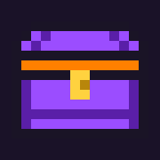
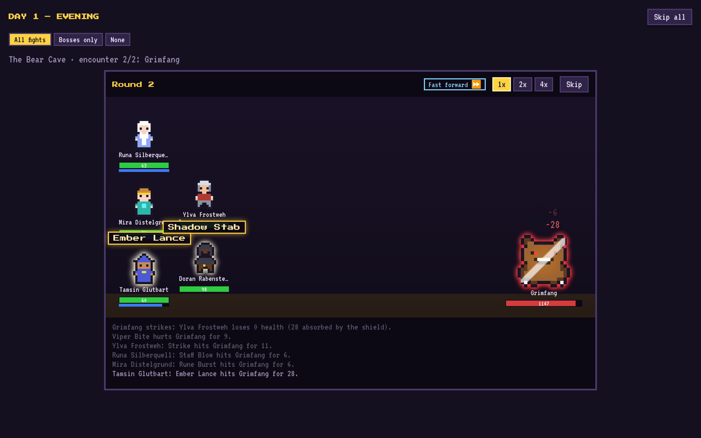
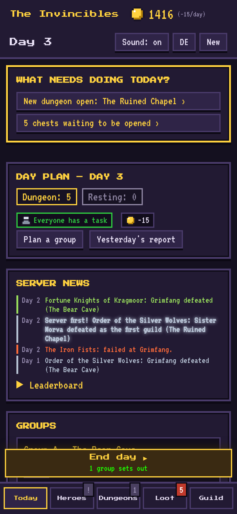
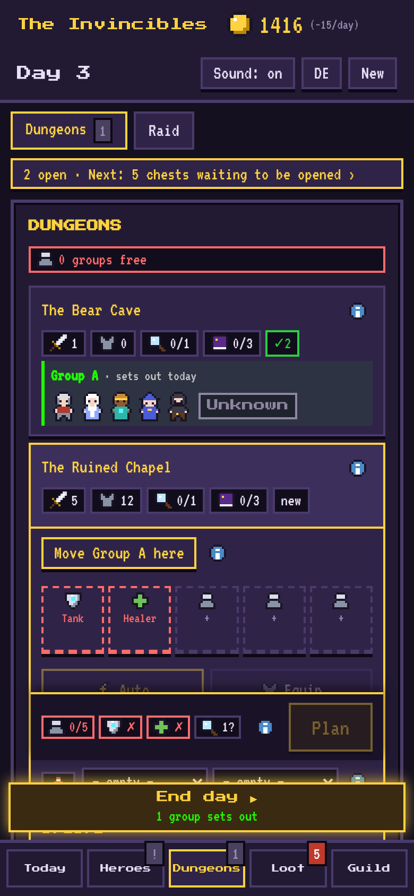
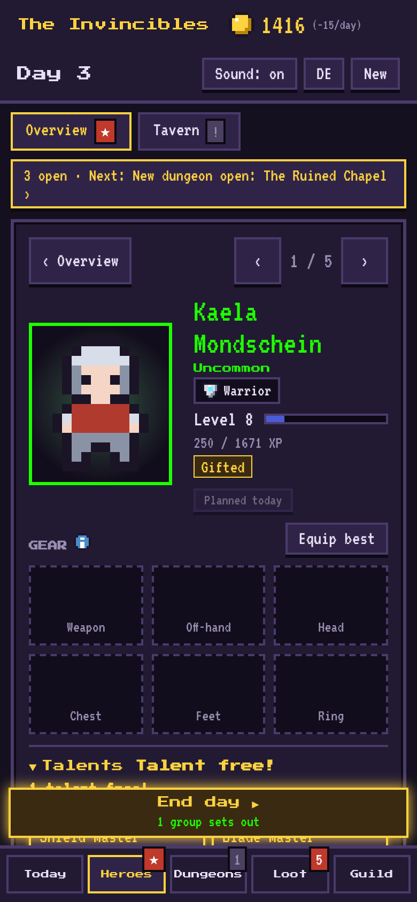
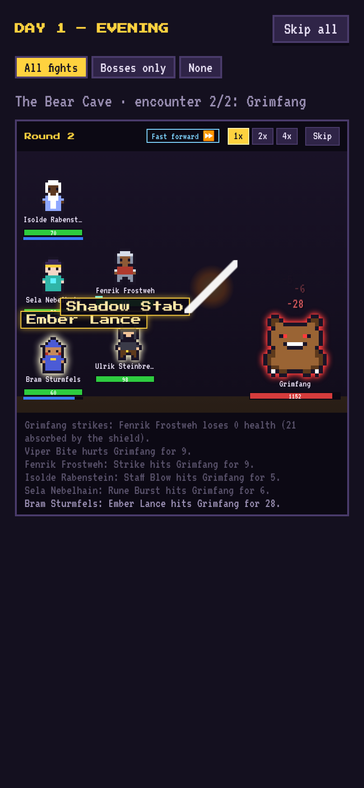
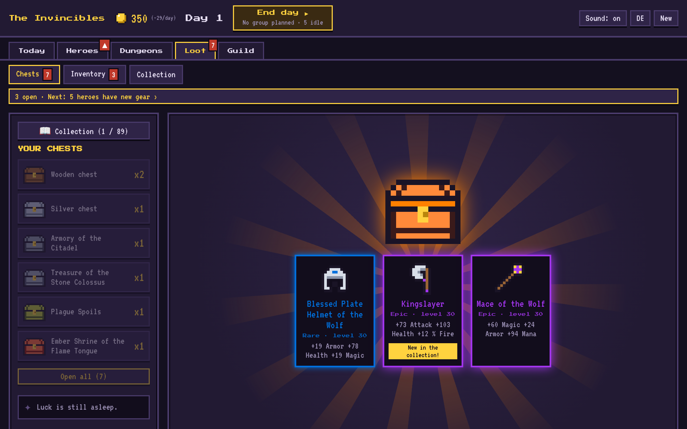
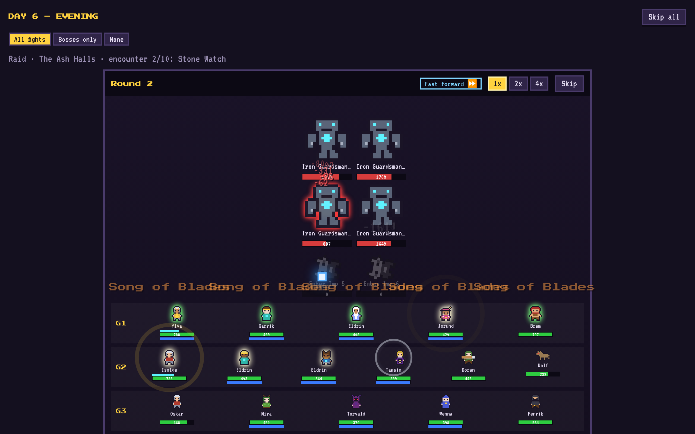

<div align="center">



# Guild Manager

**Run your MMORPG guild – without fighting yourself.**<br>
A pixel-art management game for browser and phone.

[](https://salsaheaven.github.io/gildenmanager/)




</div>

## What is it about?

You are the guild master. You hire heroes, build groups of tanks, healers and damage dealers,
give them orders and send them into dungeons. The fighting happens on its own: at the end of each day you watch
how your groups do – and then you open the loot.

Every chest makes you stronger, every boss has its tricks, and four rival guilds race you for the server firsts.
At the end awaits a 20-player raid against the final boss. Your score: how many days your guild needed to save the world.

## How it plays

| | | | |
|:-:|:-:|:-:|:-:|
|  |  |  |  |
| **Plan**<br>What needs doing today? | **Build a group**<br>Tank, healer, counters | **Gear up**<br>Items, talents, sets | **Watch**<br>Fights as a scene |

<p align="center">
  
  
</p>

1. **Plan in the morning:** who goes into which dungeon, who trains, gathers herbs or scouts the next boss?
2. **"End day":** all fights play out as a pixel scene – or you skip them.
3. **Reap in the evening:** gold, experience, level-ups and boss chests. "What went wrong" explains every defeat.
4. **Get stronger:** equip and upgrade gear, pick talents, expand the guild hall.
5. **Climb higher:** new dungeons, raid days on the weekend, the race against the other guilds.

## What's inside

- 🛡️ **15 classes** with their own skills, talents and combat orders – every choice has pros and cons
- 🗺️ **10 dungeons** with trash groups and bosses whose mechanics you need to counter (interrupt, cleanse curses, intercept, break shells, calm frenzies)
- 🐉 **2 raids with 20 heroes** in four groups: phases, tank swaps, group strikes – and Vaelor, the World Devourer
- 🎁 **Loot boxes** with rarities from      to , with a pity system
- 📖 **Collection book and 15 class sets** to complete, titles for full pages
- 🏰 **Guild hall** with 6 buildings, forging, reforging, brewing and upgrades up to +10
- ⚔️ **Rival AI guilds** with a news ticker, server firsts and a leaderboard
- 🏆 **Final evaluation** with a rank from S to D and a high-score list
- 📱 Runs in the browser on **desktop and mobile**, saves automatically, **English and German** (switch with the DE/EN button)

## Contributing

```bash
npm install
npm run dev     # game at http://localhost:5173
npm test        # all tests
npm run build   # production build in dist/
```

In the game, **F2** opens a test menu (unlock everything, gold, chests, raid test …).
Every push to `main` is tested and published to GitHub Pages automatically.

Vanilla JavaScript, Vite and Vitest, no framework. The pixel art is stored as text in `src/data/sprites.js`.
English texts live in `src/data/texts/en.js` (interface) and `src/data/en/` (game content).
Screenshots can be retaken with `node tools/screenshots.cjs` while `npm run dev` is running.

The design documents and code comments are written in German:
[KONZEPT.md](KONZEPT.md) (game design and decisions), [PLAN.md](PLAN.md) (milestones), [CLAUDE.md](CLAUDE.md) (code structure and rules).

A learning and vibe-coding project, built together with [Claude Code](https://claude.ai/code).
