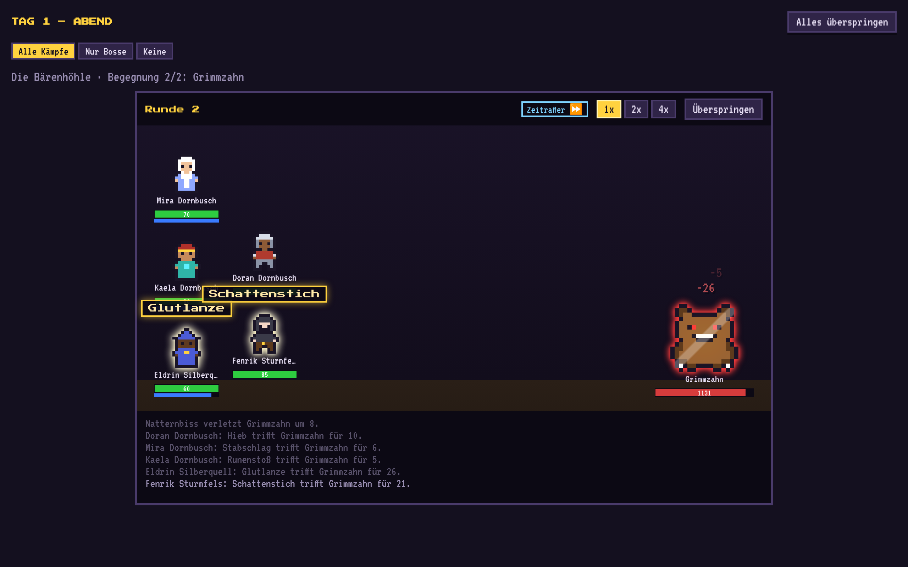
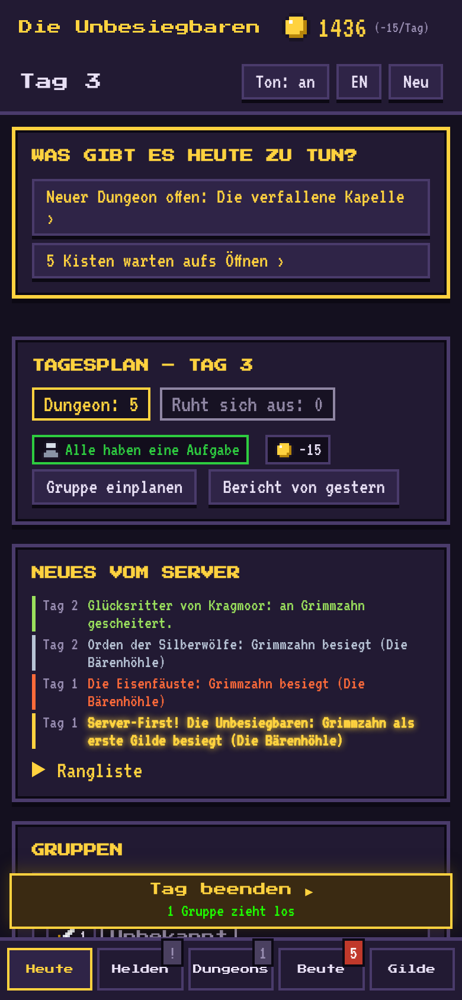
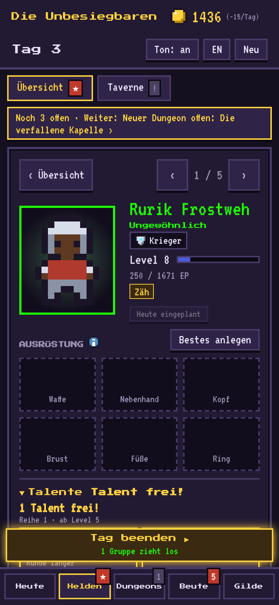
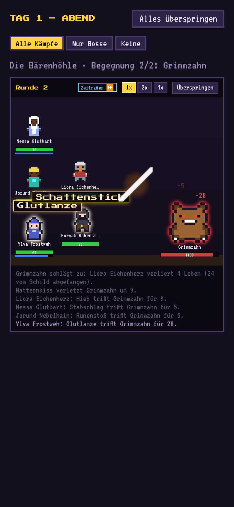
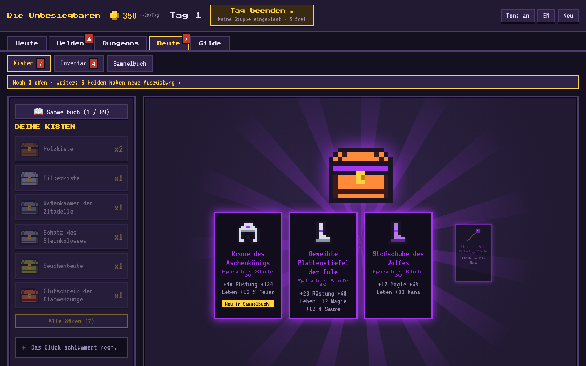
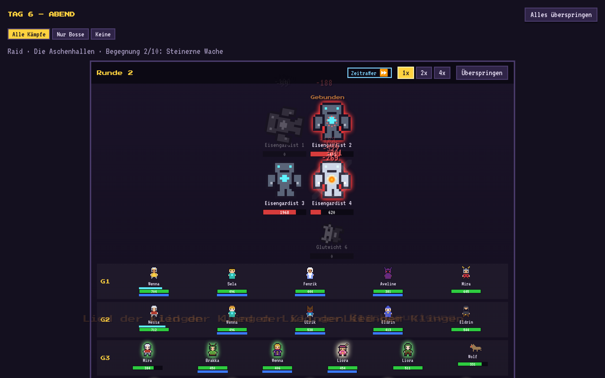

<div align="center">


# Gildenmanager

**Führe deine MMORPG-Gilde – ohne selbst zu kämpfen.**<br>
Ein Pixel-Art-Managementspiel für Browser und Handy.

[](https://salsaheaven.github.io/gildenmanager/)


[Deutsch](#worum-gehts) · [English](#english)



</div>

## Worum geht's?

Du bist Gildenmeister. Du heuerst Helden an, stellst Gruppen aus Tank, Heiler und Schadensausteilern zusammen,
gibst ihnen Anweisungen und schickst sie in Dungeons. Gekämpft wird automatisch: Am Ende jedes Tages siehst du zu,
wie sich deine Gruppen schlagen – und öffnest danach die Beute.

Mit jeder Kiste wirst du stärker, jeder Boss hat seine Tricks, und vier andere Gilden kämpfen um dieselben Server-Firsts.
Am Ende wartet ein 20-Mann-Raid mit dem Endboss. Gewertet wird, nach wie vielen Tagen deine Gilde die Welt gerettet hat.

## So spielt es sich

| | | | |
|:-:|:-:|:-:|:-:|
|  |  |  |  |
| **Planen**<br>Was gibt es heute zu tun? | **Gruppe bilden**<br>Tank, Heiler, Konter | **Ausrüsten**<br>Items, Talente, Sets | **Zuschauen**<br>Kämpfe als Szene |

<p align="center">
  
  
</p>

1. **Morgens planen:** Wer zieht in welchen Dungeon, wer trainiert, sammelt Kräuter oder erkundet den nächsten Boss?
2. **„Tag beenden“:** Alle Kämpfe laufen als Pixel-Szene ab – oder du überspringst sie.
3. **Abends ernten:** Gold, Erfahrung, Level-Ups und Boss-Kisten. „Woran es lag“ erklärt jede Niederlage.
4. **Stärker werden:** Ausrüstung anlegen und verbessern, Talente wählen, die Gildenhalle ausbauen.
5. **Weiter nach oben:** neue Dungeons, Raid-Tage am Wochenende, das Rennen gegen die anderen Gilden.

## Was drin ist

- 🛡️ **15 Klassen** mit eigenen Skills, Talenten und Kampf-Anweisungen – jede Wahl hat Vor- und Nachteile
- 🗺️ **10 Dungeons** mit Trash-Gruppen und Bossen, deren Mechaniken man kontern muss (unterbrechen, Flüche lösen, abfangen, Panzer brechen, Wutanfall dämpfen)
- 🐉 **2 Raids mit 20 Helden** in vier Gruppen: Phasen, Tankwechsel, Gruppenschläge – und Vaelor, der Weltenverschlinger
- 🎁 **Lootboxen** mit Seltenheiten von      bis , mit Pity-System
- 📖 **Sammelbuch und 15 Klassen-Sets** zum Vervollständigen, Titel für volle Seiten
- 🏰 **Gildenhalle** mit 6 Gebäuden, Schmieden, Umschmieden, Brauen und Verbessern bis +10
- ⚔️ **Rivalisierende KI-Gilden** mit Neuigkeiten-Ticker, Server-Firsts und Rangliste
- 🏆 **Endauswertung** mit Rang von S bis D und einer Bestenliste
- 📱 Läuft im Browser auf **PC und Handy**, speichert automatisch, **Deutsch und Englisch**

## Mitentwickeln

```bash
npm install
npm run dev     # Spiel unter http://localhost:5173
npm test        # alle Tests
npm run build   # fertige Version in dist/
```

Im Spiel öffnet **F2** ein Test-Menü (alles freischalten, Gold, Kisten, Raid-Test …).
Jeder Push auf `main` wird getestet und automatisch auf GitHub Pages veröffentlicht.

- [KONZEPT.md](KONZEPT.md) – Spielidee und alle Design-Entscheidungen
- [PLAN.md](PLAN.md) – Technik, Meilensteine und was als Nächstes kommt
- [CLAUDE.md](CLAUDE.md) – Aufbau des Codes und Regeln fürs Weiterbauen

Vanilla JavaScript, Vite und Vitest, ohne Framework. Die Pixel-Art steht als Text in `src/data/sprites.js`.
Ein Lern- und Vibecoding-Projekt, entwickelt zusammen mit [Claude Code](https://claude.ai/code).

---

## English

**Run an MMORPG guild – without fighting yourself.** A pixel-art management game for browser and phone.

You are the guild master: hire heroes, build groups of tank, healer and damage dealers, give them orders and send them
into dungeons. Fights play out automatically at the end of each day – then you open the loot.
Every chest makes you stronger, every boss has its tricks, and four rival guilds race you for server firsts.
At the end awaits a 20-player raid against the final boss. Your score: how many days your guild needed to save the world.

- 15 classes with skills, talents and combat orders
- 10 dungeons and 2 raids (20 heroes in four groups, phases, tank swaps)
- Loot boxes from grey to orange, pity system, collection book and 15 class sets
- Guild hall with 6 buildings, forging, brewing and upgrades up to +10
- Rival AI guilds, news ticker, leaderboard and a final ranking from S to D
- Runs in the browser on desktop and mobile, autosaves, **English and German** (switch with the DE/EN button)

**[▶ Play now](https://salsaheaven.github.io/gildenmanager/)**
